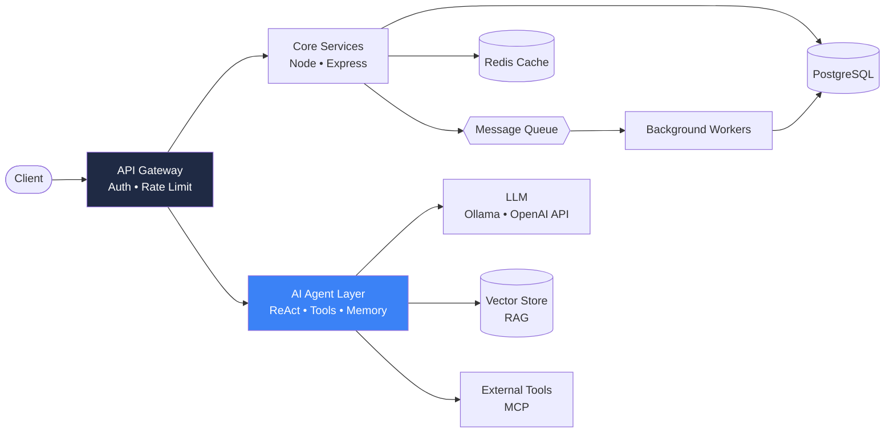

<div align="center">

[](https://git.io/typing-svg)


[](https://linkedin.com/in/abhishek015)
[](mailto:abhishekstu15@gmail.com)


</div>

---

## ⚡ Who I Am

I'm **Abhishek**, a CS-focused engineer-in-the-making (B.Tech, NIT Silchar, 2028) who builds **backend systems and AI-powered services**.

I don't just want to *use* frameworks, I want to understand what's under them. So I build the hard parts myself: auth flows, payment workflows, real-time pipelines, and an **autonomous AI agent written from zero**.

```python
class Abhishek:
    role      = "Backend + AI Engineer (in the making)"
    building  = ["Paylog", "Agentra", "AI Agent from Scratch"]
    obsessed  = ["scalability", "clean APIs", "agentic systems", "fundamentals"]
    learning  = ["system design", "distributed systems", "RAG", "MCP", "LangGraph"]
    goal      = "Design & ship production-grade, AI-powered systems from scratch"
```

---

## 🎯 The North Star

> **Backend + AI Engineer** who can take a system from a blank file to production: schema, APIs, auth, queues, caching, containers, deployment, and the **AI layer** (agents, tools, memory, retrieval) on top.



---

## 🧰 Tech Stack

<div align="center">

### 🔧 Daily Drivers


<sub>Python · JavaScript · Node.js · Express · React · Vite · PostgreSQL · Prisma · Docker · Git · GitHub · Postman · Vercel</sub>

### 🤖 AI Engineering & Systems


### 🏗️ Backend & Infrastructure


### 🚀 Leveling Up (Active Learning)


<sub>Redis · Kafka · RabbitMQ · Kubernetes · AWS · Nginx · Linux · GitHub Actions · Grafana · Prometheus</sub>

</div>

---

## 🧠 Engineering Foundations

Strong fundamentals are what make systems scale. This is the depth I'm building, topic by topic.

| Domain | What I'm mastering |
|:---|:---|
| 🔢 **Data Structures & Algorithms** | Hash maps, heaps, tries, graphs, DP, sliding window, two pointers, binary search on answer, backtracking · **300+ problems solved** |
| 🗄️ **DBMS & Storage** | ACID, transaction isolation levels, MVCC, B-Tree/Hash indexing, query planning (`EXPLAIN`), normalization vs denormalization, connection pooling, migrations |
| 🖥️ **Operating Systems** | Processes vs threads, scheduling, concurrency & deadlocks, mutex/semaphores, virtual memory, paging, I/O models, event loop internals |
| 🌐 **Computer Networks** | TCP/UDP, HTTP/1.1 → HTTP/2, TLS handshake, DNS, WebSockets, CORS, load balancing, reverse proxies, CDN basics |
| 🧩 **OOP & Design** | SOLID, design patterns (Factory, Strategy, Observer, Singleton), clean architecture, dependency injection, C++ memory model & RAII |
| 🏛️ **System Design** | CAP & PACELC, sharding, replication, consistent hashing, caching strategies, rate limiting, idempotency, pub/sub, event-driven design |
| 🔐 **API & Security** | REST maturity, versioning, pagination, JWT/refresh flows, OAuth 2.0, input validation, OWASP Top 10, secrets management |
| 🤖 **AI Systems** | ReAct loops, function calling via JSON Schema, context-window management, streaming (TTFT), embeddings, retrieval pipelines, multi-agent orchestration |

---

## 🚀 Featured Projects

### 🤖 [Autonomous AI Agent from Scratch](https://github.com/Abhi-code15/ai-agent-scratch) `🔨 In Progress`

Building an autonomous AI agent and a multi-agent system **from ground zero, without high-level abstraction frameworks**. Every layer is implemented by hand so I understand exactly how agents work.

| Layer | What I built / am building |
|:---|:---|
| 🏠 **Local inference** | Offline, zero-cost private inference with **Ollama** (`qwen2.5:1.5b`) over OpenAI-compatible REST endpoints |
| 🧠 **Memory engineering** | Persistent conversation history to beat LLM statelessness, plus context-window compaction routines |
| 🛠️ **Tool engine** | Function-calling pipelines via JSON Schema signatures and Python dynamic dispatch tables (`**kwargs`) |
| 🔁 **ReAct loop** | Iterative decision-making, chained multi-step tool calls, `MAX_STEPS` loop guards, exception self-healing |
| ⚡ **Streaming** | Low Time-To-First-Token by reassembling fragmented chunk deltas during live output |
| 🔭 **Upcoming** | **MCP**, **RAG** with semantic embeddings, stateful multi-agent graphs with **LangGraph** & **CrewAI** |

`Python 3.12+` `Ollama` `OpenAI SDK` `REST` `JSON Schema` `Git`

[📂 Repository](https://github.com/Abhi-code15/ai-agent-scratch) · [📓 Engineering Logbook](https://github.com/Abhi-code15/ai-agent-scratch/blob/main/LOGBOOK.md)

---

### 🧩 [Agentra: AI-Powered Workflow Automation Platform](https://github.com/Abhi-code15?tab=repositories&q=agentra)

A full-stack AI platform where users describe tasks and an LLM-driven backend plans and executes them through tool calling, with outputs shown in a structured interface.

- LLM integration with prompt engineering and **tool-calling** to connect user intent to real actions
- Modular Express services that cleanly separate request handling, orchestration and AI logic
- Interactive React + Vite interface for managing AI-assisted workflows
- Containerized with **Docker** for reproducible setup

`React` `Vite` `Node.js` `Express` `PostgreSQL` `LLM Integration` `Tool Calling` `Docker`

---

### 💸 [Paylog: Smart Finance & UPI Payment Tracker](https://github.com/Abhi-code15?tab=repositories&q=paylog)

A full-stack finance platform that joins expense tracking with a QR-based UPI payment workflow.

- **JWT authentication** with strict user-scoped data access to protect financial records
- RESTful APIs for income, expense and transaction management on **PostgreSQL**
- QR scanning + UPI deep-linking to start payments from any compatible UPI app
- Payment-confirmation workflow that records outcomes alongside expenses

`React` `Node.js` `Express` `PostgreSQL` `JWT` `REST APIs`

---

### ⚡ [WattWise: Real-Time Energy Analytics Platform](https://github.com/Abhi-code15?tab=repositories&q=wattwise)

A real-time analytics backend that ingests consumption readings, processes them and streams insights to a live dashboard.

- Event-driven updates with **Socket.IO** for live dashboards
- **Prisma + PostgreSQL** data layer with **Zod** request validation
- Tested with **Vitest & Supertest**; fully **Dockerized** (frontend, API, database)

`React` `Vite` `Node.js` `Express` `PostgreSQL` `Prisma` `Socket.IO` `Zod` `Docker` `Vitest`

---

## 🗺️ Roadmap: Becoming a Backend + AI Engineer

```text
 PHASE 1  ✅  Full-stack foundations   React · Node · Express · PostgreSQL · JWT · Docker
 PHASE 2  ✅  Real-time & data layers  Socket.IO · Prisma · validation · API testing
 PHASE 3  🔄  AI from first principles Local LLMs · ReAct · tool calling · memory · streaming
 PHASE 4  🔄  Scalable architecture    Caching · queues · rate limiting · load balancing
 PHASE 5  ⏭️  Advanced AI systems      RAG · MCP · LangGraph · CrewAI · multi-agent graphs
 PHASE 6  ⏭️  Cloud & production       AWS · Kubernetes · CI/CD · observability
 PHASE 7  🎯  Capstone                 A scalable, AI-powered platform built end-to-end
```

<details>
<summary><b>📈 Skill progress (click to expand)</b></summary>

<br>

| Skill | Progress |
|:---|:---|
| Backend (Node/Express/REST) |  |
| PostgreSQL & Data Modeling |  |
| Docker & Deployment |  |
| LLM Agents & Tool Calling |  |
| System Design |  |
| RAG / MCP / Multi-Agent |  |
| Cloud (AWS) & Kubernetes |  |

</details>

---

## 🧭 How I Build

- **Fundamentals first**: I implement the core idea by hand before reaching for a framework.
- **Design for scale from day one**: stateless services, clean boundaries, indexed queries.
- **Secure by default**: validated input, scoped data access, no secrets in code.
- **Tested & reproducible**: automated tests, Dockerized setups, documented decisions.
- **Learn in public**: engineering logbooks, not just code.

---

## 🏆 Highlights

- 🎓 **Siemens Scholar 2024**, selected from 10,000+ applicants nationwide
- 🥇 **HMEL Energy Quest 3.0** national winner (top 30)
- 🧠 **300+ DSA problems** solved across coding platforms
- 🤝 Core member, **NERDS Robotics Club** & technical team, **INSEES** at NIT Silchar

---

## 📊 GitHub Analytics

<div align="center">


### 🐍 Contribution Snake

<picture>
  <source media="(prefers-color-scheme: dark)" srcset="https://raw.githubusercontent.com/Abhi-code15/Abhi-code15/output/github-snake-dark.svg" />
  <source media="(prefers-color-scheme: light)" srcset="https://raw.githubusercontent.com/Abhi-code15/Abhi-code15/output/github-snake.svg" />
  
</picture>

</div>

---

## 🤝 Let's Build Something

I'm open to **internships, backend/AI engineering roles, and collaborations** on scalable systems and agentic AI.

<div align="center">

[](https://linkedin.com/in/abhishek015)
[](mailto:abhishekstu15@gmail.com)

*"Build systems that scale, and make them intelligent."*


</div>
