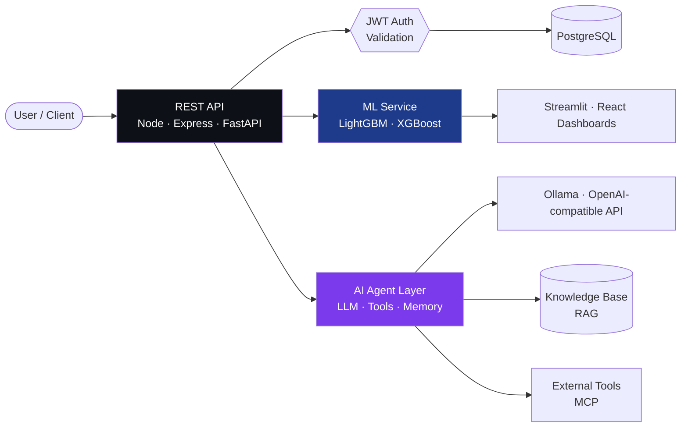

<div align="center">

[](https://git.io/typing-svg)


[](https://www.linkedin.com/in/abhishek015)
[](mailto:abhishekstu15@gmail.com)


</div>


## 👋 About Me

I'm **Abhishek**, a **B.Tech student at NIT Silchar** with a CS-focused path in **AI, backend engineering and machine learning**.

My branch gave me an early opportunity to work with **sensors, signals and real-world systems**, and that shaped how I build: from a **predictive-maintenance ML pipeline** to an **LLM agent engine** to **production-style REST backends**. I like to understand how something works from the ground up, then ship it properly.

```python
class Abhishek:
    role       = "AI + Backend Engineer (in the making)"
    languages  = ["Python", "C++", "JavaScript", "SQL"]
    ai_ml      = ["LightGBM", "XGBoost", "Scikit-learn", "RAG", "MCP", "Ollama"]
    backend    = ["Node.js", "Express", "FastAPI", "PostgreSQL", "JWT", "Docker"]
    building   = ["EngineSense", "Autonomous AI Agent Engine", "Agentra AI"]
    mindset    = "Understand it from scratch, then ship it properly."
```


## 🏗️ How I Think About Systems




## 🚀 Featured Projects

<table>
<tr>
<td width="50%" valign="top">

### 🔧 [EngineSense](https://github.com/Abhi-code15/EngineSense)
**Predictive Maintenance for Engines** · `ML`

A machine learning platform that predicts engine faults from sensor data and serves them through an interactive dashboard.

- Pipeline over **12.5K+ engine records** and **6 sensor parameters**, with leakage-free preprocessing and stratified train/val/test splits
- Tuned **LightGBM** reached **94.68% fault recall**, with **48.63% fewer missed faults** than the Random Forest baseline (5-fold CV, holdout-tested)
- **Streamlit** app with model selection, validated inference and prediction history
- **27 automated unit & integration tests** with pytest

`Python` `LightGBM` `XGBoost` `Scikit-learn` `Pandas` `Streamlit` `pytest`

[🌐 Live Demo](https://enginesense-ai.streamlit.app/) · [📂 Code](https://github.com/Abhi-code15/EngineSense)

</td>
<td width="50%" valign="top">

### 🤖 [Autonomous AI Agent Engine](https://github.com/Abhi-code15/ai-agent-from-scratch)
**LLMs → Multi-Agent Systems** · `AI` · 🔨 *in progress*

An agent engine built layer by layer, covering LLM fundamentals, retrieval and standardized tool use, with no agent framework underneath.

- Local assistant on **Ollama + Qwen 2.5** with conversational memory, system prompts and an **OpenAI-compatible API**
- **RAG pipeline** that grounds answers in custom knowledge sources
- **Model Context Protocol (MCP)** integration so the agent can reach external tools and resources
- ReAct-style loop, function calling and streaming, documented in an engineering logbook

`Python` `Ollama` `Qwen 2.5` `RAG` `MCP` `Function Calling`

[📂 Code](https://github.com/Abhi-code15/ai-agent-from-scratch)

</td>
</tr>
<tr>
<td width="50%" valign="top">

### 🧩 [Agentra AI](https://github.com/Abhi-code15/Agentra-Ai)
**AI-Powered Workflow Automation** · `AI + Backend`

A full-stack platform where users describe a task and an LLM-driven backend plans and executes it through tool calling, with results shown in a structured UI.

- **Prompt engineering and tool calling** connect user intent to real actions
- Modular **Express** services separate request handling, orchestration and AI logic
- **React + Vite** interface for managing AI-assisted workflows
- Containerized with **Docker** for reproducible setup

`React` `Vite` `Node.js` `Express` `PostgreSQL` `LLM Tool Calling` `Docker`

[📂 Code](https://github.com/Abhi-code15/Agentra-Ai)

</td>
<td width="50%" valign="top">

### 💸 [Paylog](https://github.com/Abhi-code15/Paylog)
**Smart Finance & UPI Payment Tracker** · `Backend`

A full-stack finance platform that joins expense tracking with a QR-based UPI payment workflow.

- **QR scanning and UPI deep-linking** to start payments from any compatible UPI app
- Payment-confirmation flow that records outcomes next to expenses
- **RESTful APIs** for income, expenses and transactions on **PostgreSQL**
- **JWT authentication** with strict user-scoped data access

`React` `Node.js` `Express` `PostgreSQL` `JWT` `REST`

[🌐 Live Demo](https://paylog-flow.onrender.com/) · [📂 Code](https://github.com/Abhi-code15/Paylog)

</td>
</tr>
<tr>
<td colspan="2" valign="top">

### ⚡ [WattWise](https://github.com/Abhi-code15/WattWise)
**Real-Time Energy Analytics Platform** · `Backend + Real-time`

A real-time analytics backend that ingests consumption readings, processes them and streams insights to a live dashboard. **Socket.IO** drives event-driven updates, **Prisma + PostgreSQL** form the data layer with **Zod** request validation, and the whole stack (frontend, API, database) is **Dockerized** and tested with **Vitest & Supertest**.

`React` `Vite` `Node.js` `Express` `PostgreSQL` `Prisma` `Socket.IO` `Zod` `Docker` `Vitest`

[📂 Code](https://github.com/Abhi-code15/WattWise)

</td>
</tr>
</table>


## 🧰 Tech Stack

<div align="center">

**Languages & Core**


**Backend & Web**


**AI / ML**


**Core CS**


**Tools & Deployment**


</div>


## 💼 Experience

**🏭 Siemens Scholar Trainee** · *Siemens India, Nashik* · May – Jun 2026

- Completed the **Siemens Mechatronics Systems Certification Program (Level 1)** and **Business & Manufacturing Excellence (BMEX)** under the Siemens Scholarship Program
- Contributed to the ideation and prototype design of **BhoomiAI**, an **IoT- and AI-enabled smart agriculture platform** delivering soil insights, crop recommendations and data-driven farming decisions
- Explored **Industry 4.0** and industrial automation workflows: connected systems, process data and automation for manufacturing productivity


## 🏆 Achievements & Leadership

| | |
|:---|:---|
| 🎓 **Siemens Scholar (2024)** | 1 of 300 students chosen from 10,000+ government engineering college applicants across India |
| 🥇 **HMEL Energy Quest 3.0** | One of 30 national winners |
| 🧠 **Problem Solving** | 300+ problems solved across coding platforms (DSA) |
| 🤖 **NERDS Robotics Club, NIT Silchar** | Core member; led robotics projects and club events reaching 200+ students |
| 🛠️ **INSEES, NIT Silchar** | Technical & event management; departmental workshops for 100+ students |


## 📊 GitHub Stats

<div align="center">

[](https://github.com/Abhi-code15?tab=followers)
[](https://github.com/Abhi-code15/EngineSense)


<picture>
  <source media="(prefers-color-scheme: dark)" srcset="https://raw.githubusercontent.com/Abhi-code15/Abhi-code15/output/github-snake-dark.svg" />
  <source media="(prefers-color-scheme: light)" srcset="https://raw.githubusercontent.com/Abhi-code15/Abhi-code15/output/github-snake.svg" />
  
</picture>

</div>


## 🤝 Let's Build Something

I'm open to **internships, AI / backend / ML engineering roles and collaborations**. If you're working on agents, ML products or backend systems, I'd love to talk.

<div align="center">

[](https://www.linkedin.com/in/abhishek015)
[](mailto:abhishekstu15@gmail.com)

*"Understand it from scratch. Ship it properly."*


</div>
